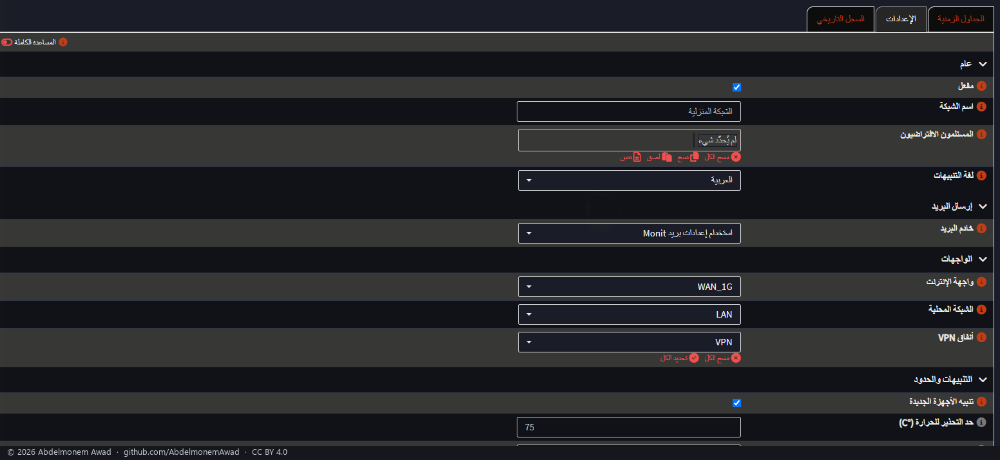
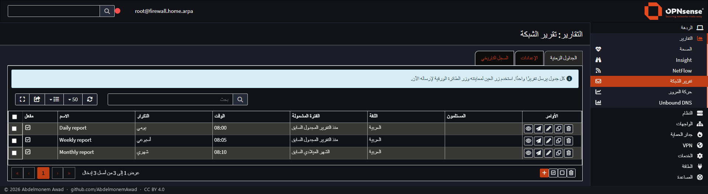
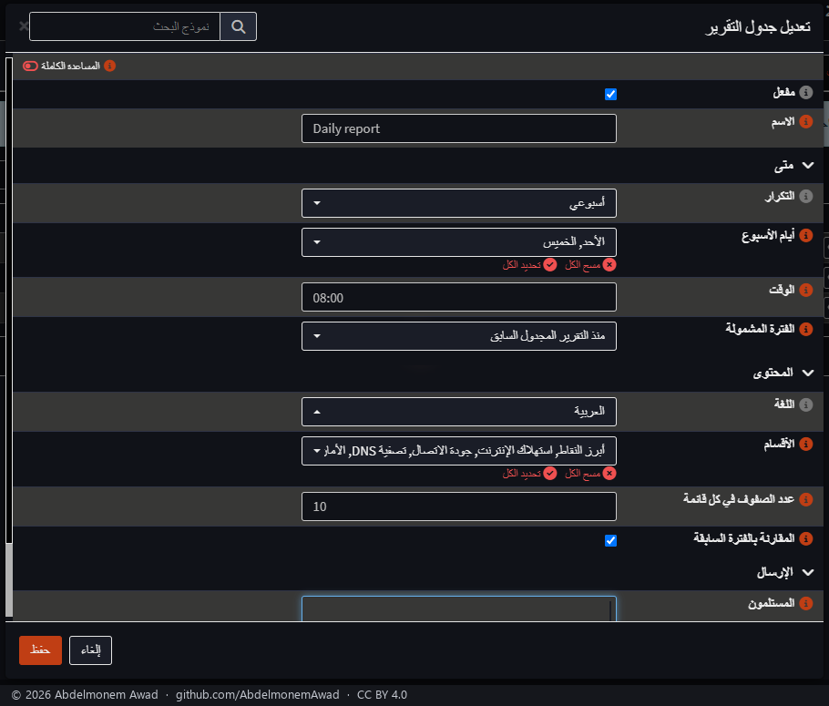

# Right-to-left layout for OPNsense

The OPNsense GUI can be translated into Arabic or Persian, but the page layout stays left to
right: the menu sits on the left, tables and forms are aligned to the left, and dropdowns open
the wrong way. This makes the translated GUI hard to read.

This project mirrors the layout when the GUI language is Arabic or Persian. Every other
language is left untouched.

Tested on OPNsense 26.7 with the opnsense-dark theme. Mirrored stylesheets are generated for
every installed theme, but the others have not been checked page by page yet.

**Status: experimental.** It covers the pages I use daily, but the GUI has several hundred
pages and I have not been through all of them. Reports of pages that look wrong are welcome.



| A table page | A dialog |
| --- | --- |
|  |  |

## What it changes

1. **The page templates** (`default.volt`, `head.inc` and the login page in `authgui.inc`) get
   a `dir="rtl"` attribute when the language is Arabic or Persian, and load a mirrored copy of
   each stylesheet instead of the original.
2. **The stylesheets.** `make_rtl_css.py` writes an `.rtl.css` copy next to every stylesheet
   of the GUI and its themes, with the horizontal geometry flipped:
   - `left`/`right` in property names (`margin-left`, `border-top-right-radius`, ...) and in
     values (`float`, `text-align`, `clear`, `background-position`, ...),
   - four-value shorthands such as `margin` and `padding`,
   - `border-radius` corners,
   - horizontal `translate()` values and resize cursors.

   Icon fonts are not mirrored, and neither is a rule whose selector already names a direction
   (`.tabulator-rtl`, `.tabulator-ltr`, `[dir=...]`, `:dir()`): it belongs to a component that
   lays itself out right to left on its own. Mirrored, Tabulator's said `direction: ltr` for its
   right-to-left mode, and every table OPNsense builds with it ran left to right in an Arabic page
   until 2026-10-19 ([#9](https://github.com/AbdelmonemAwad/opnsense-rtl/issues/9)).
3. **A few manual rules** in `rtl-extra.css` for things the automatic pass cannot fix:
   - inline styles in the templates,
   - chart text (canvas and SVG), which has to stay left to right,
   - fields that hold addresses and commands.
4. **The column titles a browser kept.** OPNsense's tables keep their columns in the browser,
   titles included, and put them back over the titles the page was rendered with - so a table seen
   before the language changed kept its old titles. A short script in the template's head forgets
   the kept titles, and only the titles, whenever the page's language is not the one they were kept
   under; widths and the columns shown stay. It runs in every language, not only a right-to-left one
   ([opnsense-arabic#9](https://github.com/AbdelmonemAwad/opnsense-arabic/issues/9)).

An appliance patched by an older version is patched again from the original templates it kept: the
mark in the template carries a version.

## Installation

Copy the repository to the firewall and run the installer as root:

```sh
fetch -o /tmp/rtl.tar.gz https://github.com/AbdelmonemAwad/opnsense-rtl/archive/refs/heads/main.tar.gz
tar -xzf /tmp/rtl.tar.gz -C /tmp
sh /tmp/opnsense-rtl-main/install.sh
```

Then reload the GUI with Ctrl+F5 so the browser drops the cached stylesheets.

The installer keeps pristine copies of the three templates in `/root/opnsense-rtl/backup`
before changing them, and checks that each patched template still compiles. If one does not,
it puts the original back and stops.

Core updates replace the templates and stylesheets. Two things apply the changes again, so
nothing has to be run by hand after an update:

- a **pkg trigger**, `/usr/local/share/pkg/triggers/opnsense-rtl.ucl`, which pkg runs the moment a
  package writes one of the three templates or a stylesheet. An update that only installs packages
  does not reboot, so this is the part that keeps the layout right straight after one. It does not
  restart the web GUI; the update does that itself when pkg is done;
- a **boot hook**, `/usr/local/etc/rc.syshook.d/start/61-opnsense-rtl`, which does the same at every
  boot.

To apply them by hand:

```sh
python3 /root/opnsense-rtl/apply_rtl.py
```

## Removing it

```sh
sh /tmp/opnsense-rtl-main/uninstall.sh
```

This removes the pkg trigger, restores the original templates, deletes the mirrored stylesheets
and removes the boot hook.

## Towards upstream

Patching installed files is a stopgap. The proper place for this is OPNsense itself: the
direction attribute in the templates, and the mirrored stylesheets generated when the themes
are built, instead of on the firewall. I intend to propose it there once it has been used for
a while; this repository is the testing ground.

## In the XGS image

[xgs-image-builder](https://github.com/AbdelmonemAwad/xgs-image-builder) builds an OPNsense image
for Sophos XGS appliances with this repository in it, installed at the image's first boot. It holds
no copy of this repository: every build takes `main` as it is that day, so a change merged here is
in the next image without anything being done there. What the image calls here - `install.sh` - is checked
from that side every day, so moving or renaming one of them is caught there; keep them where they are.

## Updates

An installed copy is updated to this repository's **releases** by hand: from **XGS: Updates**, its *Plugins*
tab ([os-xgs-npu](https://github.com/AbdelmonemAwad/os-xgs-npu)), or with `/root/opnsense-rtl/self-update.py`. ~~Once a day, at 03:13, from `/usr/local/etc/cron.d/opnsense-rtl-update`~~ - nothing
is installed on its own since 2026-10-20, at the owner's word. It asks GitHub for the latest release and, when it is ahead of what
is installed, downloads it and runs the `install.sh` it carries - the same script a hand install
runs. A change merged on `main` reaches installed firewalls when it is released, not before; with
no release published, nothing changes.

- **Only forward.** What is installed is recorded in `/usr/local/share/opnsense-rtl/installed.json` by
  the installer - the commit, from a git checkout or from the `.source-commit` stamp that an
  xgs-image-builder image or an update leaves in the tree. A firewall running something newer than
  the release is not taken back; an install from before the stamp existed takes the latest release
  once.
- **What happened** is in the system log as `self-update`, in
  `/usr/local/share/opnsense-rtl/update.json`, and the installer's output in `update.log` beside it.
- `/root/opnsense-rtl/self-update.py check` says what it would do and changes nothing.

Tested in a QEMU virtual machine against a stand-in for GitHub (no release had been published):
a release ahead is installed, one that is not is left, no release and an unreachable GitHub change
nothing, and the uninstaller removes the updater, its cron entry and the stamp.

## License

BSD 2-Clause, the same as OPNsense. See [LICENSE](LICENSE).

The photographs and screenshots under `docs/` are &copy; 2026 Abdelmonem Awad, under [CC BY 4.0](https://creativecommons.org/licenses/by/4.0/): use them freely, naming the author and linking here. Each carries that notice in a strip added below it.
